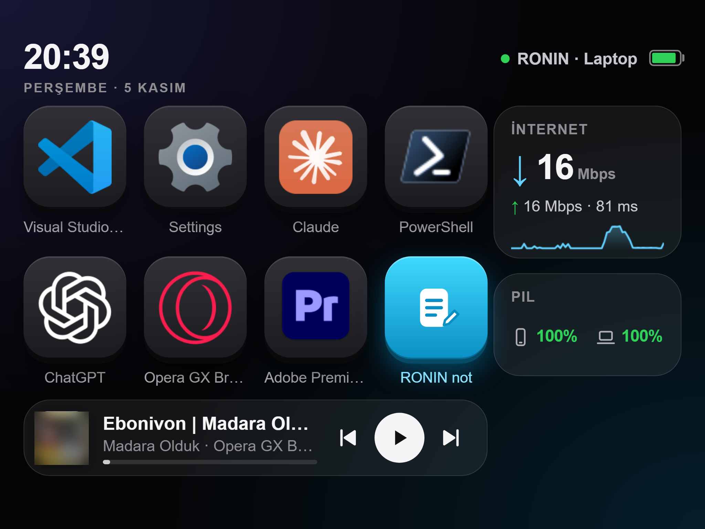

# RONIN Deck

Turn an old iPhone or iPad into a Stream Deck-style control panel for your **Windows** laptop. No app install on the device: it's a web page you add to the home screen, served by a small Python server on the laptop over your Wi-Fi.



A Windows port of [OldPhoneDeck](https://github.com/GLAUCOMA82/OldPhoneDeck), which is Mac-only (Swift + AppleScript). The phone page is adapted from the original; the server and all Windows integration are new.

## Features

- **7 app keys.** Any app from your Start menu, with its real icon. Hold a key to change the set.
- **Note key.** Type or dictate a quick note on the device; it is appended as a checkbox to a Markdown file on the laptop (works great with Obsidian).
- **Now playing.** Title, artist, artwork and play/pause/next/previous for any player that shows up in Windows' media controls (Spotify, browsers, YouTube, etc.).
- **Internet card.** Live traffic graph plus a speed test (download/upload/ping).
- **Battery card.** Laptop battery level and charging state.
- **Runs on very old devices.** The page is ES5 only, so it works in iOS 8/9 Safari (e.g. an iPad Air 2 or older).

## Requirements

- Windows 10/11
- Python 3.12 (other 3.10+ versions should work)
- The laptop and the device on the same Wi-Fi

## Install

```powershell
git clone https://github.com/DEY-code-007/ronin-deck.git
cd ronin-deck
python -m venv .venv
.venv\Scripts\pip install -r requirements.txt
```

Optional: copy `config.example.json` to `data/config.json` and edit it (see below).

## Run

Double-click `start_deck.cmd`, which starts the server hidden on port **8805**. On first start it creates a random access token and writes the device link to `data/url.txt`:

```
http://<laptop-ip>:8805/#k=<token>
```

Open that link in Safari on the device, then **Share → Add to Home Screen**. The token is saved on the device, so the icon opens straight into the deck.

You may need to allow Python through Windows Firewall on private networks the first time.

To stop it, end the `pythonw.exe` process whose command line contains `deck_server.py`.

**Start with Windows:** put a shortcut to `start_deck.cmd` in `shell:startup`.

## Configuration (`data/config.json`, optional)

| Key | Default | What |
| --- | --- | --- |
| `name` | `Deck · <COMPUTERNAME>` | Name shown top-right on the deck |
| `note_path` | `notes.md` in this folder | Markdown file the note key appends to (`~` allowed) |
| `note_header` | `# Deck notes` | Written once when the notes file is created; `{date}` is replaced |
| `note_open_uri` | empty | What holding the note key opens, e.g. an `obsidian://open?...` link. Empty means the notes file itself |

## Security

- Local network only: the server listens on your LAN, not the internet.
- Every route except the page shell needs the token (`data/token`). To revoke access, delete `data/token` and restart; a new one is generated.
- Only apps from the Start-menu listing can be launched; arbitrary commands are impossible.
- `data/` holds your token, link and app choices and is git-ignored. Never share `data/url.txt`.

## Files

| File | What |
| --- | --- |
| `deck_server.py` | HTTP server, token check, routes, network/battery stats, speed test |
| `winapps.py` | Start-menu apps via `Get-StartApps`, icons via `IShellItemImageFactory` (ctypes), launch via `shell:AppsFolder` |
| `media.py` | Now playing and transport controls via Windows SMTC (`winsdk`) |
| `web/index.html` | The device page (ES5) |
| `start_deck.cmd` | Starts the server hidden with the venv's `pythonw.exe` |

## Notes

- The UI is in Turkish (it was built for a Turkish user). The strings are all in `web/index.html` if you want to translate them.
- Removed from the original: the Phone tab (camera/mic), Bluetooth peripheral batteries and Claude deep links.
- If the laptop's IP changes (DHCP), the saved link breaks. A DHCP reservation on your router fixes that.

## License

MIT. See `LICENSE` (this port) and `LICENSE-OldPhoneDeck` (the original project).
